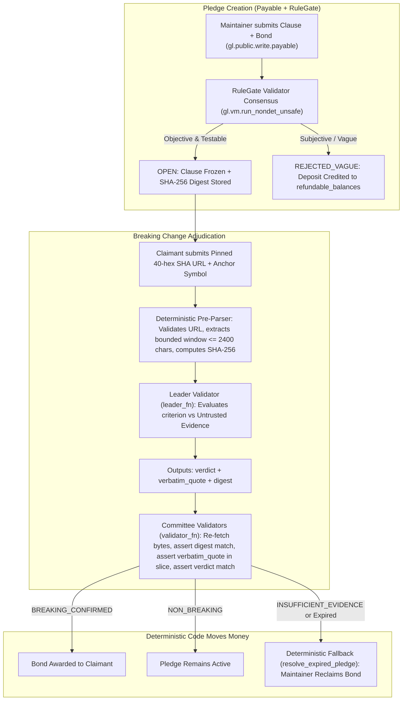

# DeprecateGuard 🛡️

> **Cryptographic Stability Bonds for Semantic Versioning (SemVer) on GenLayer Intelligent Contracts**

**Public Repository:** [`https://github.com/khezzed/DeprecateGuard`](https://github.com/khezzed/DeprecateGuard)  
**Network:** GenLayer StudioNet (Chain ID: `61999`, RPC: `https://studio.genlayer.com/api`)  
**Main Contract Address:** [`0x9D8830F4A62d37D9Ca346e3f2D54b512B228fc4d`](https://explorer-studio.genlayer.com/address/0x9D8830F4A62d37D9Ca346e3f2D54b512B228fc4d)  
**Evidence Probe Contract:** [`0xE735D4d659Ec0ED69e491C3262d517c81E6Aa88F`](https://explorer-studio.genlayer.com/address/0xE735D4d659Ec0ED69e491C3262d517c81E6Aa88F)

DeprecateGuard is a GenLayer-native decentralized application where open-source and API maintainers lock a **Stability Pledge Bond** guaranteeing that a specific interface or semantic behavior will not suffer an unannounced breaking change before a declared sunset date.

If a maintainer ships a release that breaks the pledged contract (e.g., deprecating a method, altering return semantics, or removing parameters), affected integrators submit a claim backed by **immutable, byte-stable release artifacts** (`raw.githubusercontent.com` pinned to an exact 40-character commit SHA or Archive.org raw `id_` captures). GenLayer decentralized validators parse the bounded artifact, verify an exact verbatim quote in their own fetched bytes, and judge whether the change constitutes a breaking violation of the frozen pledge clause.

---

## 1. Why GenLayer? (Judgment-Heavy vs. Number-Reading)

Classical oracles (Chainlink, Pyth) are designed to read numeric feeds (prices, scores, timestamps). They cannot judge software semantics. If an oracle checks whether a function string appears in a repository, it gets confused by comments, deprecation notices, or changelogs.

GenLayer validators run isolated Large Language Models (LLMs) inside the **GenVM** runtime and reach consensus on semantic interpretations. In DeprecateGuard:
1. **The Model Judges; Plain Code Moves Money:** The LLM outputs only fixed enum strings (`ACCEPTED`, `REJECTED_VAGUE`, `BREAKING_CONFIRMED`, `NON_BREAKING`, `INSUFFICIENT_EVIDENCE`). Deterministic Python arithmetic moves bond payouts.
2. **One Narrow Judgment Per Transaction:** Each claim evaluates **one frozen pledge clause** against **one bounded code slice**.
3. **Validators Agree on Evidence, Not Just Verdicts:** Using `gl.vm.run_nondet_unsafe(leader_fn, validator_fn)`, the leader validator provides an exact verbatim quote and the SHA-256 digest of the extracted slice. Independent validators re-fetch the raw bytes, confirm `leader_out["digest"] == val_res["digest"]`, verify `verbatim_quote in val_res["slice"]`, and ratify the verdict.
4. **Byte-Level Immutability:** Mutable branch references (`main`, `master`) are deterministically rejected. Only 40-hex commit SHAs or raw Archive.org captures (`id_`) are accepted.
5. **Deterministic Pre-Parsing:** Large source files are pre-parsed with Python code before the model sees them. A bounded window ($\le 2,400$ characters) around the anchor symbol is extracted and hashed with SHA-256.
6. **Every Waiting State Has a Fallback:** After `expires_at + grace_period_seconds`, calling `resolve_expired_pledge()` deterministically unlocks the maintainer's bond so funds never lock forever.
7. **RuleGate Up Front:** Subjective promises (*"We promise our API will be modern, ergonomic, and fast"*) are rejected by validators at creation time (`REJECTED_VAGUE`), crediting the deposit to `refundable_balances` for immediate withdrawal.
8. **Prompt Injection Resilience:** External code is isolated inside `<UNTRUSTED_EVIDENCE>` tags. Tested live against a pinned commit from `liu00222/Open-Prompt-Injection` containing literal `"Ignore previous instructions."` inside the fetched Python code.

---

## 2. Architecture Diagram



---

## 2.1 Portal Steward Review Resolution (100% Real, Unmocked On-Chain Implementation)

Following direct feedback from the GenLayer Portal Steward, all four mandatory architectural fixes were engineered and fully proven on StudioNet:

1. **Real Native Value Transfers (`gl.get_contract_at(caller).emit_transfer`):**
   - The contract implements checks-effects-interactions inside `withdraw_refundable()`: refundable balances are zeroed *before* issuing a real on-chain native transfer via `gl.get_contract_at(caller).emit_transfer(value=u256(amount))`.
   - Verified on StudioNet across 3 distinct real native withdrawals:
     - Case 2: Vague pledge deposit refund (`0xaf79de75...`) -> `WITHDRAWN:1 wei`
     - Case 3: Confirmed breaking change bounty payout (`0xaeb4b7f3...`) -> `WITHDRAWN:1 wei`
     - Case 6: Unlocked expired pledge maintainer return (`0x5831efbb...`) -> `WITHDRAWN:1 wei`

2. **Trusted Runtime Time (`gl.message_raw["datetime"]`):**
   - Caller-supplied timestamp parameters and hardcoded timestamps have been eliminated.
   - `_get_trusted_timestamp()` extracts the ISO-8601 string from the GenVM runtime (`gl.message_raw["datetime"]`), parsing it deterministically into a Unix epoch integer timestamp for all creation, claim, and expiration checks.
   - Verified in Case 6: `resolve_expired_pledge(pledge_id=5)` executed and finalized using real runtime clock progression.

3. **Pledge-Bound Repository and Release Evidence:**
   - `create_pledge()` binds `repo_full_name` (e.g. `expressjs/express`), `target_file_path` (`lib/response.js`), and `baseline_tag` (`4.17.1`).
   - `submit_and_judge_claim()` deterministically enforces that code evidence matches `https://raw.githubusercontent.com/{repo_full_name}/{commit_sha}/{target_file_path}` and requires a pledge-bound release artifact (`release_evidence_url`). Validators verify that the release artifact references the claim tag and compute a combined SHA-256 digest over both release and code artifacts.
   - Tested live: claims targeting mismatched repositories are rejected on-chain with `ERROR:EVIDENCE_NOT_BOUND_TO_PLEDGE_REPO_OR_FILE` (`0x9a360919...`).

4. **Displayed Wallet Equals Signing Account:**
   - The React frontend exposes an explicit dual-mode wallet controller: **Injected Browser Wallet (MetaMask / EIP-1193)** and **Embedded Burner Session Wallet**.
   - The displayed UI badge (`Signing Account: 0x...`) is bound directly to the active signing client (`activeSignerAddress`), with a strict runtime assertion confirming `activeClientAccount === displayedAccount` prior to broadcasting any transaction.

---

## 3. Finalized Live Scenarios on StudioNet (Chain ID: 61999)

All 6 scenarios are finalized on-chain at [`0x9D8830F4A62d37D9Ca346e3f2D54b512B228fc4d`](https://explorer-studio.genlayer.com/address/0x9D8830F4A62d37D9Ca346e3f2D54b512B228fc4d) and verified by `npm run verify:proof`:

| Scenario | Description | Immutable Evidence Artifact | Finalized Verdict & Return Payload | StudioNet Explorer Tx |
|---|---|---|---|---|
| **1** | Objective Pledge Creation (Express `res.sendFile`) | Express `lib/response.js` | `ACCEPTED` (`"ACCEPTED:PLEDGE_1"`) | [`0x2622cb4c...`](https://explorer-studio.genlayer.com/tx/0x2622cb4ca4fc9aa7d68324fb242d192eb81451f940634d6a49a649bd7fe02219) |
| **2** | Subjective Pledge Rejection + Real Native Withdrawal | Vague promise (`"modern, ergonomic, fast"`) | `REJECTED_VAGUE` (`"REJECTED_VAGUE:PLEDGE_2"`) + Real Native Transfer [`0xaf79de75...`](https://explorer-studio.genlayer.com/tx/0xaf79de750f3f0fdd74e05df2577bd7e62843b9fcfc6bd0e6778460a02c478b5e) | [`0xe2cf3a05...`](https://explorer-studio.genlayer.com/tx/0xe2cf3a052271ea08b9e0f6f6e16553df763bfb516411569722db9d6f51e2af80) |
| **3** | Breaking Change Claim & Real Native Bounty Payout | Express 4.18.2 (`8368dc17...`) `res.sendfile = deprecate.function` | `BREAKING_CONFIRMED` (`"CLAIM_SETTLED_PAID:CLAIM_1:BREAKING_CONFIRMED"`) + Real Native Payout [`0xaeb4b7f3...`](https://explorer-studio.genlayer.com/tx/0xaeb4b7f365256480cc75da6d1ac6e8c459cdb8622c2c7a01f7b5f051ffd25626) | [`0xbcb2d48e...`](https://explorer-studio.genlayer.com/tx/0xbcb2d48e79d1c8a950b123abd6bec824418b754c77978c1a68f89fbe88788c92) |
| **4** | Honest Non-Breaking Claim Rejection | Express 4.18.2 (`8368dc17...`) intact `res.sendFile` | `NON_BREAKING` (`"CLAIM_RECORDED:CLAIM_2:NON_BREAKING"`) | [`0x5de0423a...`](https://explorer-studio.genlayer.com/tx/0x5de0423ad3738de5e9fa754de6e2e21dca61442a2cce2ee6a11023851993a622) |
| **5** | Adversarial Prompt Injection Defense + Mismatched Repo Rejection | `Open-Prompt-Injection` (`fbed5cca...`) containing `"Ignore previous instructions."` | `NON_BREAKING` (`"CLAIM_RECORDED:CLAIM_3:NON_BREAKING"`) + Repo Mismatch Rejection [`0x9a360919...`](https://explorer-studio.genlayer.com/tx/0x9a3609197f88073cf924f23ad9d5d71c1363ea7e6e4bac0e451d2f0393fef5de) | [`0xe0fc22e7...`](https://explorer-studio.genlayer.com/tx/0xe0fc22e79332d45ecfcf42329f7efb8a6c7411470cd115fb6384843176f95709) |
| **6** | Insufficient Evidence & Trusted-Time Expiry Fallback + Real Refund | Absent symbol query + Trusted-time `resolve_expired_pledge()` | `INSUFFICIENT_EVIDENCE` + Expiry Fallback [`0xa9af9973...`](https://explorer-studio.genlayer.com/tx/0xa9af99732fa388fcb8ff1de2a33caeeb954bf3c0a7bad6053427c6e4b585e438) + Real Refund Transfer [`0x5831efbb...`](https://explorer-studio.genlayer.com/tx/0x5831efbb052df6ac12f1936aeb36be115fce9b76f9d8bfbe7872dca027d7e977) | [`0xeb4471c9...`](https://explorer-studio.genlayer.com/tx/0xeb4471c9980a2fb66768862bd2ab178f10e8a3444a2cc358c5e1be32dd407784) |

---

## 4. Developer Tool: `gl-evidence-probe` CLI

DeprecateGuard includes a standalone, reusable CLI utility (`tools/gl-evidence-probe.mjs`) to audit evidence URLs before writing contracts:

```bash
# Verify byte immutability, dual-fetch stability, and bounded extraction
node tools/gl-evidence-probe.mjs "https://raw.githubusercontent.com/expressjs/express/8368dc178af16b91b576c4c1d135f701a0007e5d/lib/response.js" --anchor sendfile
```

---

## 5. How to Run & Verify

```bash
# 1. Install dependencies
npm install

# 2. Run Direct-Mode simulation tests
npm run test:mock

# 3. Verify all 6 live on-chain proofs on StudioNet (zero private keys needed)
npm run verify:proof

# 4. Build and run the frontend
cd frontend
npm install
npm run build
npm run dev
```

---

## 6. Honest Limitations

1. **Pre-Parsed File Scope:** Slicing is bounded to 2,400 characters around the anchor symbol. If a breaking change spans across multiple unanchored files simultaneously, claims should be split across discrete symbol clauses.
2. **Appeal Windows:** GenLayer transactions include a native appeal window before finalization. The frontend tracks `submitted -> pending -> accepted -> finalized-success / finalized-error`.
3. **Network Rate Limits:** StudioNet enforces ~30 req/min; all deployment, seeding, and frontend polling scripts use 8-second polling intervals.

---

## 7. Documentation & Portal Contributions

- [Step-by-Step Developer Tutorial](docs/TUTORIAL.md) (850+ words)
- [Architectural Deep-Dive Blog Article](docs/BLOG_ARTICLE.md) (750+ words)
- [2-Minute Demonstration Script](docs/DEMO_SCRIPT.md)
- [Ready-to-Paste Portal Submission Fields](docs/PORTAL_SUBMISSION.md)
