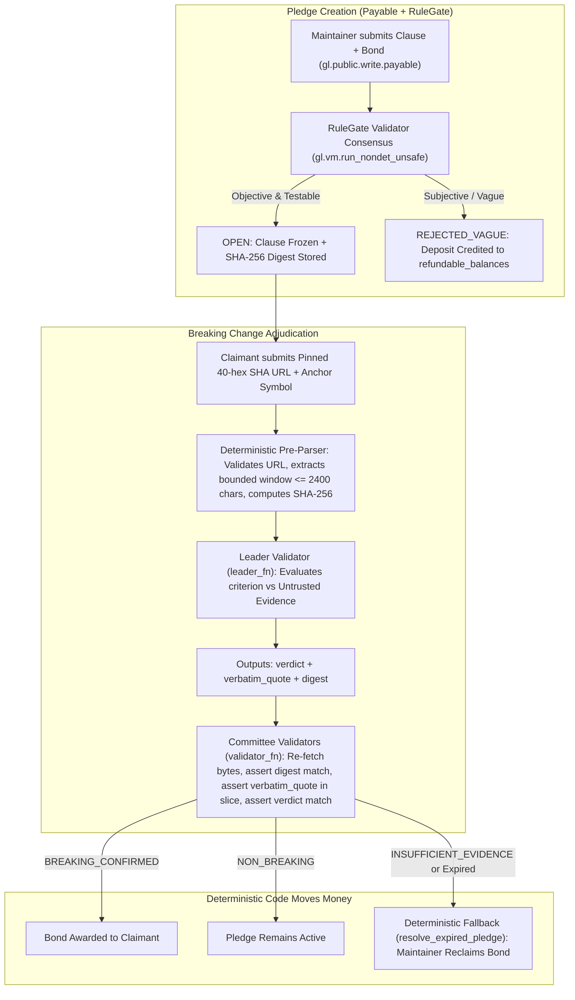

# DeprecateGuard 🛡️

> **Cryptographic Stability Bonds for Semantic Versioning (SemVer) on GenLayer Intelligent Contracts**

**Public Repository:** [`https://github.com/khezzed/DeprecateGuard`](https://github.com/khezzed/DeprecateGuard)  
**Network:** GenLayer StudioNet (Chain ID: `61999`, RPC: `https://studio.genlayer.com/api`)  
**Main Contract Address:** [`0x0645f04f8Fb89451Fa0c2B3c6F5E4cbD724Fb531`](https://explorer-studio.genlayer.com/address/0x0645f04f8Fb89451Fa0c2B3c6F5E4cbD724Fb531)  
**Evidence Probe Contract:** [`0xE735D4d659Ec0ED69e491C3262d517c81E6Aa88F`](https://explorer-studio.genlayer.com/address/0xE735D4d659Ec0ED69e491C3262d517c81E6Aa88F)

DeprecateGuard is a GenLayer-native decentralized application where open-source and API maintainers lock a **Stability Pledge Bond** guaranteeing that a specific interface or semantic behavior will not suffer an unannounced breaking change before a declared sunset date.

If a maintainer ships a release that breaks the pledged contract (e.g., deprecating a method, altering return semantics, or removing parameters), affected integrators submit a claim backed by **immutable, byte-stable release artifacts** (`raw.githubusercontent.com` pinned to an exact 40-character commit SHA or Archive.org raw `id_` captures). GenLayer decentralized validators parse the bounded artifact, verify an exact verbatim quote in their own fetched bytes, and judge whether the change constitutes a breaking violation of the frozen pledge clause.

---

## 1. Why GenLayer? (Judgment-Heavy vs. Number-Reading)

Classical oracles (Chainlink, Pyth) are designed to read numeric feeds (prices, scores, timestamps). They cannot judge software semantics. If an oracle checks whether a function string appears in a repository, it gets confused by comments, deprecation notices, or changelogs.

GenLayer validators run isolated Large Language Models (LLMs) inside the **GenVM** runtime and reach consensus on semantic interpretations. In DeprecateGuard:
1. **The Model Judges; Plain Code Moves Money:** The LLM outputs only fixed enum strings (`ACCEPTED`, `REJECTED_VAGUE`, `BREAKING_CONFIRMED`, `NON_BREAKING`, `INSUFFICIENT_EVIDENCE`). Deterministic Python arithmetic moves bond payouts.
2. **One Narrow Judgment Per Transaction:** Each claim evaluates **one frozen pledge clause** against **one bounded code slice**.
3. **Validators Agree on Evidence, Not Just Verdicts:** Using `gl.vm.run_nondet_unsafe(leader_fn, validator_fn)`, the leader validator provides an exact verbatim quote and the SHA-256 digest of the extracted slice. Independent validators re-fetch the raw bytes, confirm `leader_out["digest"] == val_res["digest"]`, verify `verbatim_quote in val_res["slice"]`, and ratify the verdict.
4. **Byte-Level Immutability:** Mutable branch references (`main`, `master`) are deterministically rejected. Only 40-hex commit SHAs or raw Archive.org captures (`id_`) are accepted.
5. **Deterministic Pre-Parsing:** Large source files are pre-parsed with Python code before the model sees them. A bounded window ($\le 2,400$ characters) around the anchor symbol is extracted and hashed with SHA-256.
6. **Every Waiting State Has a Fallback:** After `expires_at + grace_period_seconds`, calling `resolve_expired_pledge()` deterministically unlocks the maintainer's bond so funds never lock forever.
7. **RuleGate Up Front:** Subjective promises (*"We promise our API will be modern, ergonomic, and fast"*) are rejected by validators at creation time (`REJECTED_VAGUE`), crediting the deposit to `refundable_balances` for immediate withdrawal.
8. **Prompt Injection Resilience:** External code is isolated inside `<UNTRUSTED_EVIDENCE>` tags. Tested live against a pinned commit from `liu00222/Open-Prompt-Injection` containing literal `"Ignore previous instructions."` inside the fetched Python code.

---

## 2. Architecture Diagram



---

## 3. Finalized Live Scenarios on StudioNet (Chain ID: 61999)

All 6 scenarios are finalized on-chain at [`0x0645f04f8Fb89451Fa0c2B3c6F5E4cbD724Fb531`](https://explorer-studio.genlayer.com/address/0x0645f04f8Fb89451Fa0c2B3c6F5E4cbD724Fb531) and verified by `npm run verify:proof`:

| Scenario | Description | Immutable Evidence Artifact | Finalized Verdict & Return Payload | StudioNet Explorer Tx |
|---|---|---|---|---|
| **1** | Objective Pledge Creation (Express `res.sendFile`) | Express `lib/response.js` | `ACCEPTED` (`"ACCEPTED:PLEDGE_1"`) | [`0xc39597f7...`](https://explorer-studio.genlayer.com/tx/0xc39597f74e279ea29f6637a4471294b6c5f32701314dee90f9036d0b29914fd5) |
| **2** | Subjective Pledge Rejection + Refund Withdrawal | Vague promise (`"modern, ergonomic, fast"`) | `REJECTED_VAGUE` (`"REJECTED_VAGUE:PLEDGE_2"`) + Withdraw [`0x04e1766a...`](https://explorer-studio.genlayer.com/tx/0x04e1766afe25ed25c8ac9aa05f1c6d149064f26e4d660710e957ad9c0345db3e) | [`0xb73415e7...`](https://explorer-studio.genlayer.com/tx/0xb73415e7075773cefcd8e500a38a88993fbeaf2eb97b2521ac339fa53658aa23) |
| **3** | Breaking Change Claim & Bond Settlement | Express 4.18.2 (`8368dc17...`) `res.sendfile = deprecate.function` | `BREAKING_CONFIRMED` (`"CLAIM_SETTLED_PAID:CLAIM_1:BREAKING_CONFIRMED"`) | [`0x5246e1f8...`](https://explorer-studio.genlayer.com/tx/0x5246e1f868746b57d6566a2786876617ae51763aa0d09a24d2a3d5c1cd86fe10) |
| **4** | Honest Non-Breaking Claim Rejection | Express 4.18.2 (`8368dc17...`) intact `res.sendFile` | `NON_BREAKING` (`"CLAIM_RECORDED:CLAIM_2:NON_BREAKING"`) | [`0x8a2852ae...`](https://explorer-studio.genlayer.com/tx/0x8a2852ae7c25976800032db41e412b8e5ae936b3e69733c744a5f429ba380ea7) |
| **5** | Adversarial Prompt Injection Defense | `Open-Prompt-Injection` (`fbed5cca...`) containing `"Ignore previous instructions."` | `NON_BREAKING` (`"CLAIM_RECORDED:CLAIM_3:NON_BREAKING"`) | [`0x04d21a7e...`](https://explorer-studio.genlayer.com/tx/0x04d21a7e64ebc1dc3ae4e184d7d39b305f2b74e09cb1cdec88a437782912a3b6) |
| **6** | Insufficient Evidence & Deadline Fallback | Absent symbol query + `resolve_expired_pledge()` | `INSUFFICIENT_EVIDENCE` + Fallback [`0x1d3c84d4...`](https://explorer-studio.genlayer.com/tx/0x1d3c84d48222ea141cc6eb788b9a81f8750bf2e94133b1939718fa613cf33d8c) | [`0xc02ae20c...`](https://explorer-studio.genlayer.com/tx/0xc02ae20c49a468bcfa0d08d7acc02cffa267b0238c7c9bfae68a23607e5b174f) |

---

## 4. Developer Tool: `gl-evidence-probe` CLI

DeprecateGuard includes a standalone, reusable CLI utility (`tools/gl-evidence-probe.mjs`) to audit evidence URLs before writing contracts:

```bash
# Verify byte immutability, dual-fetch stability, and bounded extraction
node tools/gl-evidence-probe.mjs "https://raw.githubusercontent.com/expressjs/express/8368dc178af16b91b576c4c1d135f701a0007e5d/lib/response.js" --anchor sendfile
```

---

## 5. How to Run & Verify

```bash
# 1. Install dependencies
npm install

# 2. Run Direct-Mode simulation tests
npm run test:mock

# 3. Verify all 6 live on-chain proofs on StudioNet (zero private keys needed)
npm run verify:proof

# 4. Build and run the frontend
cd frontend
npm install
npm run build
npm run dev
```

---

## 6. Honest Limitations

1. **Pre-Parsed File Scope:** Slicing is bounded to 2,400 characters around the anchor symbol. If a breaking change spans across multiple unanchored files simultaneously, claims should be split across discrete symbol clauses.
2. **Appeal Windows:** GenLayer transactions include a native appeal window before finalization. The frontend tracks `submitted -> pending -> accepted -> finalized-success / finalized-error`.
3. **Network Rate Limits:** StudioNet enforces ~30 req/min; all deployment, seeding, and frontend polling scripts use 8-second polling intervals.

---

## 7. Documentation & Portal Contributions

- [Step-by-Step Developer Tutorial](docs/TUTORIAL.md) (850+ words)
- [Architectural Deep-Dive Blog Article](docs/BLOG_ARTICLE.md) (750+ words)
- [2-Minute Demonstration Script](docs/DEMO_SCRIPT.md)
- [Ready-to-Paste Portal Submission Fields](docs/PORTAL_SUBMISSION.md)
