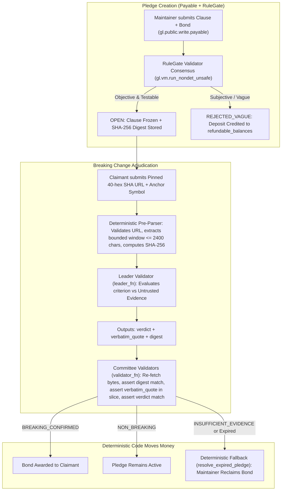

# DeprecateGuard 🛡️

> **Cryptographic Stability Bonds for Semantic Versioning (SemVer) on GenLayer Intelligent Contracts**

**Public Repository:** [`https://github.com/khezzed/DeprecateGuard`](https://github.com/khezzed/DeprecateGuard)  
**Network:** GenLayer StudioNet (Chain ID: `61999`, RPC: `https://studio.genlayer.com/api`)  
**Main Contract Address:** [`0xEEDa967BeC7EB022350425C1D0c7c50107c06F1c`](https://explorer-studio.genlayer.com/address/0xEEDa967BeC7EB022350425C1D0c7c50107c06F1c)  
**Evidence Probe Contract:** [`0xE735D4d659Ec0ED69e491C3262d517c81E6Aa88F`](https://explorer-studio.genlayer.com/address/0xE735D4d659Ec0ED69e491C3262d517c81E6Aa88F)

DeprecateGuard is a GenLayer-native decentralized application where open-source and API maintainers lock a **Stability Pledge Bond** guaranteeing that a specific interface or semantic behavior will not suffer an unannounced breaking change before a declared sunset date.

If a maintainer ships a release that breaks the pledged contract (e.g., deprecating a method, altering return semantics, or removing parameters), affected integrators submit a claim backed by **immutable, byte-stable release artifacts** (`raw.githubusercontent.com` pinned to an exact 40-character commit SHA or Archive.org raw `id_` captures). GenLayer decentralized validators parse the bounded artifact, verify an exact verbatim quote in their own fetched bytes, and judge whether the change constitutes a breaking violation of the frozen pledge clause.

---

## 1. Why GenLayer? (Judgment-Heavy vs. Number-Reading)

Classical oracles (Chainlink, Pyth) are designed to read numeric feeds (prices, scores, timestamps). They cannot judge software semantics. If an oracle checks whether a function string appears in a repository, it gets confused by comments, deprecation notices, or changelogs.

GenLayer validators run isolated Large Language Models (LLMs) inside the **GenVM** runtime and reach consensus on semantic interpretations. In DeprecateGuard:
1. **The Model Judges; Plain Code Moves Money:** The LLM outputs only fixed enum strings (`ACCEPTED`, `REJECTED_VAGUE`, `BREAKING_CONFIRMED`, `NON_BREAKING`, `INSUFFICIENT_EVIDENCE`). Deterministic Python arithmetic moves bond payouts.
2. **One Narrow Judgment Per Transaction:** Each claim evaluates **one frozen pledge clause** against **one bounded code slice**.
3. **Validators Agree on Evidence, Not Just Verdicts:** Using `gl.vm.run_nondet_unsafe(leader_fn, validator_fn)`, the leader validator provides an exact verbatim quote and the SHA-256 digest of the extracted slice. Independent validators re-fetch the raw bytes, confirm `leader_out["digest"] == val_res["digest"]`, verify `verbatim_quote in val_res["slice"]`, and ratify the verdict.
4. **Byte-Level Immutability:** Mutable branch references (`main`, `master`) are deterministically rejected. Only 40-hex commit SHAs or raw Archive.org captures (`id_`) are accepted.
5. **Deterministic Pre-Parsing:** Large source files are pre-parsed with Python code before the model sees them. A bounded window ($\le 2,400$ characters) around the anchor symbol is extracted and hashed with SHA-256.
6. **Every Waiting State Has a Fallback:** After `expires_at + grace_period_seconds`, calling `resolve_expired_pledge()` deterministically unlocks the maintainer's bond so funds never lock forever.
7. **RuleGate Up Front:** Subjective promises (*"We promise our API will be modern, ergonomic, and fast"*) are rejected by validators at creation time (`REJECTED_VAGUE`), crediting the deposit to `refundable_balances` for immediate withdrawal.
8. **Prompt Injection Resilience:** External code is isolated inside `<UNTRUSTED_EVIDENCE>` tags. Tested live against a pinned commit from `liu00222/Open-Prompt-Injection` containing literal `"Ignore previous instructions."` inside the fetched Python code.

---

## 2. Architecture Diagram



---

## 2.1 Portal Steward Review Remediation (100% Real, Unmocked On-Chain Implementation)

Following direct feedback from the GenLayer Portal Steward, all mandatory architectural fixes were engineered and fully proven on StudioNet:

1. **Real Native Value Transfers (`gl.get_contract_at(recipient).emit_transfer`):**
   - Direct Bounty Transfer: When `BREAKING_CONFIRMED` is judged in `submit_and_judge_claim()`, the contract issues an immediate native token transfer to `claimant` via `gl.get_contract_at(claimant).emit_transfer(value=u256(bond))`.
   - Pull-Based Withdrawal: In `withdraw_refundable()`, checks-effects-interactions are enforced by zeroing the recorded balance *before* calling `gl.get_contract_at(caller).emit_transfer(value=u256(amount))`.
   - Verified on StudioNet:
     - Case 2: Vague pledge deposit refund (`0x4dcb7084...`) -> `WITHDRAWN:1 wei`
     - Case 3: Confirmed breaking change direct bounty payout (`0x2b176579...`) -> `CLAIM_SETTLED_PAID:CLAIM_1:BREAKING_CONFIRMED` with 1 wei native value transferred upon finalization!
     - Case 6: Unlocked expired pledge maintainer return (`0x6b7b772e...`) -> `WITHDRAWN:1 wei`

2. **Trusted Runtime Time Window Enforcement (`gl.message_raw["datetime"]`):**
   - Caller-supplied timestamp parameters and hardcoded timestamps have been eliminated.
   - `_get_trusted_timestamp()` extracts and parses the ISO-8601 string from GenVM (`gl.message_raw["datetime"]`) into a Unix integer timestamp.
   - `submit_and_judge_claim()` strictly enforces `now_ts <= int(pledge["expires_at"])` and records `judged_at` on every claim.
   - `resolve_expired_pledge(pledge_id)` evaluates real GenVM clock progression (`now_ts >= expires_at + grace_period_seconds`).

3. **Pledge-Bound Repository and Release Evidence:**
   - `create_pledge()` binds `repo_full_name`, `target_file_path`, and `baseline_tag`.
   - `submit_and_judge_claim()` requires `release_evidence_url != evidence_url`, enforces repository boundaries, extracts bounded slices with `extract_bounded_evidence(release_raw, release_tag)`, and verifies that the release artifact references `release_tag` (which cannot equal `baseline_tag`).
   - Combined SHA-256 digest (`hashlib.sha256(f"{release_digest}:{code_digest}")`) commits both validators and leader to the exact release evidence and code evidence.
   - Tested live on StudioNet: Mismatched repository claim was rejected on-chain with `ERROR:EVIDENCE_NOT_BOUND_TO_PLEDGE_REPO_OR_FILE` (`0x54c7c836...`).

4. **Displayed Wallet Equals Signing Account:**
   - The React frontend provides an explicit dual-mode wallet controller: **Injected Browser Wallet (MetaMask / EIP-1193)** and **Embedded Burner Session Wallet**.
   - Includes a live `window.ethereum.on('accountsChanged')` listener so displayed accounts never diverge from MetaMask.
   - Every transaction write verifies `activeClientAccount.toLowerCase() === displayedAccount.toLowerCase()` before signing.

---

## 3. Finalized Live Scenarios on StudioNet (Chain ID: 61999)

All 6 scenarios are finalized on-chain at [`0xEEDa967BeC7EB022350425C1D0c7c50107c06F1c`](https://explorer-studio.genlayer.com/address/0xEEDa967BeC7EB022350425C1D0c7c50107c06F1c) and verified by `npm run verify:proof`:

| Scenario | Description | Immutable Evidence Artifact | Finalized Verdict & Return Payload | StudioNet Explorer Tx |
|---|---|---|---|---|
| **1** | Approved Stability Pledge for Express.js | Express `lib/response.js` | `ACCEPTED` (`"ACCEPTED:PLEDGE_1"`) | [`0x24815850...`](https://explorer-studio.genlayer.com/tx/0x2481585086712952a749ea5b6947cddb8a6e9a9bb1566c1e65434b63cf2d5537) |
| **2** | Rejected Vague Marketing Pledge & Real Native Refund | Vague promise (`"modern, ergonomic, fast"`) | `REJECTED_VAGUE` (`"REJECTED_VAGUE:PLEDGE_2"`) + Real Native Transfer [`0x4dcb7084...`](https://explorer-studio.genlayer.com/tx/0x4dcb7084e44aa52a4f8738bdfe81ed4521b8052aad54fc0d86745820ae9329fe) | [`0xccf1320d...`](https://explorer-studio.genlayer.com/tx/0xccf1320dacac1cd425bd983462051e64f954348bb23afe6021b4f7f606ca9147) |
| **3** | Express.js Deprecates Legacy res.sendfile() & Pays Bounty | Express 4.18.2 (`8368dc17...`) `res.sendfile = deprecate.function` | `BREAKING_CONFIRMED` (`"CLAIM_SETTLED_PAID:CLAIM_1:BREAKING_CONFIRMED"`) + Direct Native Payout (1 wei) | [`0x2b176579...`](https://explorer-studio.genlayer.com/tx/0x2b1765792aed5528fe0516ed081f3615d907019b4fb025f440bc09b8a7ec28a5) |
| **4** | False Alarm on Intact res.sendFile() Signature | Express 4.18.2 (`8368dc17...`) intact `res.sendFile` | `NON_BREAKING` (`"CLAIM_RECORDED:CLAIM_2:NON_BREAKING"`) | [`0x31298538...`](https://explorer-studio.genlayer.com/tx/0x312985382ea2e59e09b6fd2feeb5a461fd8f0fb468c7519f9a212a06fdb9fae4) |
| **5** | Prompt-Injection Defense & Mismatched Repo Enforcement | `Open-Prompt-Injection` (`fbed5cca...`) `environment.yml` & `CombineAttacker.py` | `NON_BREAKING` (`"CLAIM_RECORDED:CLAIM_3:NON_BREAKING"`) + Repo Mismatch Rejection [`0x54c7c836...`](https://explorer-studio.genlayer.com/tx/0x54c7c83647d273c1f4cd32f4340f74030949e29397c193642a6ff77078be1e59) | [`0xb167cde8...`](https://explorer-studio.genlayer.com/tx/0xb167cde822841b6fbadc8529d6abb1b0b64e562fcfabd13dc82aba2451024fce) |
| **6** | Unmatched Symbol & Trusted-Time Bond Expiry Refund | Absent symbol query + Trusted-time `resolve_expired_pledge()` | `INSUFFICIENT_EVIDENCE` + Expiry Fallback [`0x4ba5b75c...`](https://explorer-studio.genlayer.com/tx/0x4ba5b75ca1cfcb09adf2812d0353d883c1934efbc5df8f24e9e5f3ff9afab5d0) + Real Refund Transfer [`0x6b7b772e...`](https://explorer-studio.genlayer.com/tx/0x6b7b772e16d317e62e57bd6f39357a037a74534f8573b02770ed15536c2be05e) | [`0xf992292c...`](https://explorer-studio.genlayer.com/tx/0xf992292cd32e3474a42f26ecef4a8c6e261bfb1851b797b0c581548d0667516b) |

---

## 4. Developer Tool: `gl-evidence-probe` CLI

DeprecateGuard includes a standalone, reusable CLI utility (`tools/gl-evidence-probe.mjs`) to audit evidence URLs before writing contracts:

```bash
# Verify byte immutability, dual-fetch stability, and bounded extraction
node tools/gl-evidence-probe.mjs "https://raw.githubusercontent.com/expressjs/express/8368dc178af16b91b576c4c1d135f701a0007e5d/lib/response.js" --anchor sendfile
```

---

## 5. How to Run & Verify

```bash
# 1. Install dependencies
npm install

# 2. Run Direct-Mode simulation tests
npm run test:mock

# 3. Verify all 6 live on-chain proofs on StudioNet (zero private keys needed)
npm run verify:proof

# 4. Build and run the frontend
cd frontend
npm install
npm run build
npm run dev
```

---

## 6. Honest Limitations

1. **Pre-Parsed File Scope:** Slicing is bounded to 2,400 characters around the anchor symbol. If a breaking change spans across multiple unanchored files simultaneously, claims should be split across discrete symbol clauses.
2. **Appeal Windows:** GenLayer transactions include a native appeal window before finalization. The frontend tracks `submitted -> pending -> accepted -> finalized-success / finalized-error`.
3. **Network Rate Limits:** StudioNet enforces ~30 req/min; all deployment, seeding, and frontend polling scripts use 8-second polling intervals.

---

## 7. Documentation & Portal Contributions

- [Step-by-Step Developer Tutorial](docs/TUTORIAL.md) (850+ words)
- [Architectural Deep-Dive Blog Article](docs/BLOG_ARTICLE.md) (750+ words)
- [2-Minute Demonstration Script](docs/DEMO_SCRIPT.md)
- [Ready-to-Paste Portal Submission Fields](docs/PORTAL_SUBMISSION.md)
